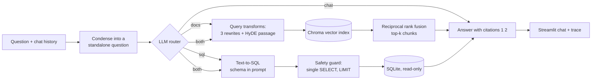
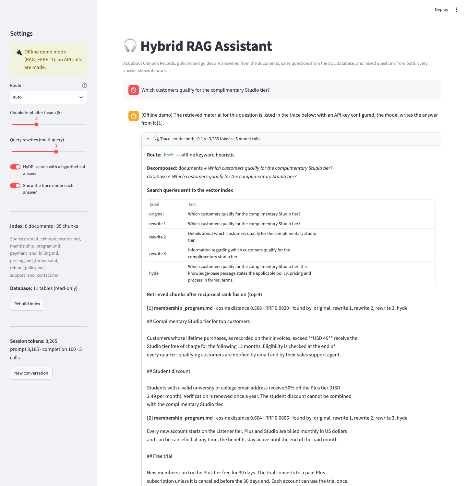

# Hybrid RAG Assistant

A question-answering assistant that combines **retrieval-augmented generation over documents**
with **Text-to-SQL over a relational database**, and shows its work for every answer.

Ask "How long do I have to request a refund?" and it searches the knowledge-base documents.
Ask "Which genre sells the most tracks?" and it writes and runs a read-only SQL query.
Ask "Which customers qualify for the complimentary Studio tier?" and it does both: the
membership rule comes from a document, the qualifying customers from the invoices table.

> **中文简介**：一个“文档 + 数据库”混合问答助手。LLM 路由器判断问题应走向量检索、Text-to-SQL
> 还是两者结合；检索前做多路查询改写与 HyDE，并用 RRF 融合结果；回答附带引用编号；SQL 侧为只读
> 连接并有安全校验。提供 Streamlit 对话界面（可展开查看路由、检索片段、SQL 与 token 消耗）、
> 命令行、检索策略评测脚本和无需 API key 的离线测试模式。技术栈：OpenAI API、LangChain、
> Chroma、tiktoken、SQLite、Streamlit。

## What happens to a question



1. **Condense.** A follow-up such as *"and for students?"* is rewritten into a standalone
   question using the conversation history, so retrieval never depends on chat context.
2. **Route.** A model call returns JSON: `docs`, `sql`, `both` or `chat`, with a reason. For
   `both` it also **decomposes** the question into a document sub-question and a database
   sub-question.
3. **Transform and retrieve** (`docs`, `both`). The question is rewritten into three
   alternative phrasings (multi-query) and a short hypothetical answer passage (HyDE). Every
   variant is searched in the Chroma index; the result lists are merged with **reciprocal rank
   fusion** and the top-k chunks are numbered `[1]`, `[2]`, ... for citation.
4. **Text-to-SQL** (`sql`, `both`). The model sees the schema (`CREATE TABLE` statements plus
   sample rows) and writes one query. A guard accepts only a single `SELECT`/`WITH` statement,
   rejects write keywords and appends a `LIMIT`; the query runs on a connection opened with
   `mode=ro`.
5. **Answer.** The model answers only from the material it was given, cites excerpts by number
   and states what a database query measured. The reply is streamed to the UI.
6. **Trace.** Every step is recorded: route and reason, generated queries, hits with cosine
   distance, fusion score and which queries found them, the SQL and its rows, and the tokens
   spent on the question (counted from the API, estimated with `tiktoken` when streaming).

## Screenshot



*Offline demo mode (`RAG_FAKE=1`): the trace shows a real routing, retrieval and SQL run; the
answer text is a placeholder because no model is called in this mode.*

## Demo dataset: Chinook Records

The assistant is domain-agnostic; the repository ships with a demo for a fictional digital
music store built on the public-domain [Chinook](https://github.com/lerocha/chinook-database)
sample database:

- `data/chinook.db`: 11 tables, 3,503 tracks, 59 customers, 412 invoices, 8 employees.
- `data/docs/*.md`: six hand-written knowledge-base documents (pricing and formats, refund
  policy, membership programme, support, payment and billing, company overview). They were
  written to be consistent with the database, so mixed questions have real answers, for example
  the membership document says the Studio tier is free above USD 45 of lifetime purchases, and
  the invoices show which customers are above it.

Replace the documents and the database with your own: any `.md`/`.txt` files in `DOCS_DIR`
and any SQLite file in `SQLITE_DB` work without code changes.

## Quick start

```bash
git clone https://github.com/biyxx24/hybrid-rag-assistant.git
cd hybrid-rag-assistant
pip install -r requirements.txt
cp .env.example .env        # add your OPENAI_API_KEY; adjust the base URL / model names
streamlit run app.py
```

The dependency versions match the INFO 5940 course environment, so the project also runs
unchanged in a course Codespace (where `OPENAI_API_KEY` and `OPENAI_BASE_URL` are already set).
The `.env.example` points at the Cornell AI API Gateway; for `api.openai.com` remove
`OPENAI_BASE_URL` and use plain model names such as `gpt-4o` and `text-embedding-3-small`.

Open `http://localhost:8501/?q=your+question` to start the app with a question already asked.

The first run embeds the documents and writes the index to `.chroma/`. It is rebuilt
automatically when the documents, the chunking parameters or the embedding model change, or on
demand with the **Rebuild index** button.

### Command line

```bash
python cli.py "Which genre sells the most tracks?" --trace
python cli.py "Is there a student discount?" --route docs --rewrites 0 --no-hyde
```

### Offline mode (no API key)

```bash
RAG_FAKE=1 streamlit run app.py
RAG_FAKE=1 python cli.py "How long do I have to request a refund?" --trace
```

Offline mode swaps the embedding model for a deterministic hashing embedding and the chat model
for a rule-based stand-in (`hybrid_rag/fakes.py`). Retrieval, fusion, routing, SQL generation
and the guard all run for real; only the natural-language answer is a placeholder. The test
suite and the evaluation harness use the same stand-ins.

### Tests

```bash
pytest
```

28 tests cover the SQL guard and read-only execution, chunking and index reuse, hashing
embeddings, rank fusion, every route of the pipeline, history condensing, router fallbacks and
error reporting. They run offline in about a second.

### Evaluating retrieval strategies

```bash
python -m eval.evaluate          # real models
python -m eval.evaluate --fake   # offline smoke test of the harness
```

`eval/gold_questions.json` holds 20 questions, each labelled with the document that answers it.
The script retrieves with four strategies (baseline, multi-query + RRF, HyDE, both) and reports
`hit@k`, mean reciprocal rank and the number of model calls per question, as a Markdown table
saved to `eval/results.md`. The questions deliberately use everyday wording ("get my money
back") where the documents use formal wording ("reimbursement window"), which is the case
query transformations are meant to help with.

## Project layout

| Path | What it does |
| --- | --- |
| `app.py` | Streamlit chat UI with settings sidebar, streaming answers and the trace panel |
| `cli.py` | One question from the terminal, optional JSON trace |
| `hybrid_rag/config.py` | Settings from environment variables / `.env` |
| `hybrid_rag/llm.py` | OpenAI chat wrapper with usage accounting, streaming, JSON and list parsing |
| `hybrid_rag/indexing.py` | Document loading, chunking, fingerprinted Chroma index |
| `hybrid_rag/transforms.py` | Condense with history, multi-query rewriting, HyDE |
| `hybrid_rag/retrieval.py` | Vector search, reciprocal rank fusion, numbered context |
| `hybrid_rag/router.py` | Route decision and question decomposition (JSON output) |
| `hybrid_rag/sql_tool.py` | Schema extraction, SQL generation, cleaning, guard, read-only execution |
| `hybrid_rag/pipeline.py` | Orchestration and the `Trace` record |
| `hybrid_rag/fakes.py` | Offline embedding and chat stand-ins |
| `eval/` | Gold questions and the retrieval evaluation script |
| `tests/` | pytest suite (offline) |
| `data/` | Demo documents and the Chinook SQLite database |

## Techniques and where they come from

The project grew out of the INFO 5940 (Cornell) hands-on notebooks and extends them:

| Course topic | Used here | Extension |
| --- | --- | --- |
| Chat Completions, message roles, conversation history | `llm.py`, `pipeline.py`, `app.py` | history condensed into standalone questions before retrieval |
| Token counting with `tiktoken` | `llm.py` | per-question and per-session token accounting, estimate when the stream reports none |
| Streamlit chatbot with session state and streaming | `app.py` | trace panel, example prompts, index rebuild |
| LangChain loaders, `RecursiveCharacterTextSplitter`, `OpenAIEmbeddings`, Chroma | `indexing.py` | fingerprinted on-disk index that rebuilds only when inputs change |
| Text-to-SQL with `SQLDatabase`, cleaning model output, read-only SQLite | `sql_tool.py` | statement guard, automatic `LIMIT`, error surfaced to the user instead of raised |
| Query rewriting, expansion, decomposition, HyDE | `transforms.py`, `router.py` | rewrites and HyDE fused with reciprocal rank fusion; decomposition driven by the router |
| Comparing what different queries retrieve | `eval/evaluate.py` | measured on a labelled gold set (hit@k, MRR, calls per question) |

New pieces not covered in the course: the LLM router with structured JSON output, reciprocal
rank fusion, citation-numbered context, the offline stand-ins and the test suite.

## Design notes and limitations

- **Why a router instead of always doing both?** Running retrieval and SQL for every question
  roughly doubles the cost and adds irrelevant material to the prompt. The router costs one
  small call and makes the trace easier to read. Routes can be forced from the sidebar.
- **Why fuse instead of concatenating queries?** Searching once with the rewrites joined
  together produces one blurred embedding. Searching each variant and fusing the rankings
  rewards chunks that several phrasings agree on, and the trace shows which phrasing found what.
- **Safety.** The database connection is read-only and the guard allows one `SELECT`; still,
  generated SQL can be *wrong* (a join that double-counts, an ambiguous "biggest"). The SQL is
  always shown so the reader can check it, and the answer prompt asks the model to say what the
  query measured.
- **Limits.** Chunks are character-based, not semantic; retrieval is dense only (no keyword
  search); the router is a single call without retries; and the demo documents are short, so
  the differences between retrieval strategies are small on this dataset.

## License

MIT. The Chinook sample database is by Luis Rocha and is distributed under its own
[license](https://github.com/lerocha/chinook-database/blob/master/LICENSE.md).
